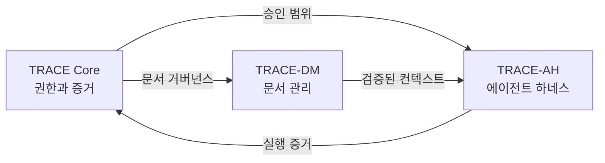

# TRACE-GATE Framework

[English](README.md) | **한국어**

소프트웨어 전달 거버넌스를 위한 증거 기반 프레임워크입니다. 요청, 승인 범위, 정본 문서 컨텍스트, 관측된 효과, 다음 행동의 권한을 연결하여 중단된 에이전트 세션 사이에서도 판단 근거를 유지합니다.

이 저장소는 규격, 기계 처리 계약, Python 참조 구현과 합성 테스트를 제공합니다. 아키텍처는 연구 제안이며 참조 구현은 일부 계약을 실행 가능한 형태로 검증합니다. 테스트 통과만으로 운영 안전성, 분산 권한 통제나 실제 운영 효과가 입증되는 것은 아닙니다.

**공식 저장소:** [401SPAG/trace-gate-framework](https://github.com/401SPAG/trace-gate-framework) · [401SPAG](https://401spag.com) · [문의](mailto:mail@401spag.com)

## TRACE의 의미

| 원칙 | 의미 | 핵심 질문 |
|---|---|---|
| **T — Trace** | 요청·결정·증거의 추적성 | 왜 작업하며 무엇이 승인되었는가? |
| **R — Restrict** | 권한과 영향 범위 제한 | 무엇을 바꿀 수 있고 무엇을 보호해야 하는가? |
| **A — Assemble** | 복구 경로를 갖춘 제한된 능력 단위 조립 | 작업을 어떤 관리 가능한 단위로 나눌 것인가? |
| **C — Confirm** | 증거에 근거한 사실 확인 | 무엇을 관측했고 무엇이 아직 미확정인가? |
| **E — Elevate** | Gate를 통한 추가 운영 권한 부여 | 언제 다음 단계를 승인할 수 있는가? |

**Gate**는 증거에 근거한 의사결정 지점이며 별도 약어가 아닙니다. 평가 통과 자체가 실행·승격 권한을 부여하지는 않습니다. 여기서 TRACE의 다섯 원칙은 같은 이름을 사용하는 다른 프로젝트와 별개입니다.

## 세 가지 책임

| 영역 | 책임 |
|---|---|
| **TRACE Core** | 요청·경계·승인·증거와 추가 권한에 관한 결정 |
| **TRACE-DM — Document Management(문서 관리)** | 정본 문서, 개정본, 계보, 무결성, 최신성과 목적에 한정된 컨텍스트 |
| **TRACE-AH — Agent Harness(에이전트 하네스)** | 중재된 모델·도구 실행, 관측, 검증, 체크포인트와 검증된 재개 |



세 영역은 논리적 책임이며 함께 배포할 수 있습니다. 요약과 검색 결과는 파생 컨텍스트이고, 관련성이 있다는 이유만으로 권위를 갖지는 않습니다. 의미 기반 검색, 다중 에이전트 조율, TRACE-DM-MIGRATION은 필요한 경우 선택하는 확장입니다.

## 유지해야 할 조건

- **효과가 발생하기 전** 요청·승인·범위·관련 문서 개정본을 연결합니다.
- 시도, 성공 보고, 관측된 효과를 구별합니다. 타임아웃은 무변경의 증거가 아닙니다.
- 결과가 미확정인 쓰기는 같은 실행에서 차단을 유지합니다. 실제 효과를 조사한 뒤 복구 또는 새로 승인된 실행을 결정합니다.
- 승인·컨텍스트·실행 이력·범위·원래 한도의 유효성을 확인한 뒤 재개합니다. 체크포인트 자체는 재개 허락이 아닙니다.
- 신뢰할 수 있는 관측·승인 확인, 보호된 증거와 독립적인 원장 기준점, 필요한 환경 수준의 동시 변경 통제를 갖춥니다.

참조 런타임은 단일 프로세스 예제입니다. Python 핸들러의 타임아웃은 반환 후 검사하며 실행 중인 도구를 강제로 중단하지 않습니다. 운영 실행기는 별도의 격리·마감 시각 통제·실제 효과 대조를 제공해야 합니다. [구현 가이드](docs/REFERENCE-IMPLEMENTATION.ko.md)를 확인하십시오.

## 로컬에서 시작하기

사용 전 [라이선스 적용 범위](LICENSING.md)를 확인하십시오. 패키지 메타데이터는 Python **3.11 이상**을 요구하며 CI와 같은 검증에는 **3.12**를 사용합니다. Python 3.15의 gzip 호환성 문제는 [구현 가이드](docs/REFERENCE-IMPLEMENTATION.ko.md#2-설치와-검증)에 기록했습니다. 저장소를 내려받은 디렉터리에서 프로젝트별 가상환경을 사용합니다(POSIX 명령).

```bash
python3.12 -m venv .venv
.venv/bin/python -m pip install -e '.[dev]'
.venv/bin/python scripts/validate_templates.py
.venv/bin/python -m pytest -q
.venv/bin/python scripts/evaluate_gate.py \
  templates/gate-decision.yaml examples/gate-facts.yaml
.venv/bin/python examples/runtime_demo.py
```

예제는 합성 입력을 사용하며 실제 원격 변경을 수행하지 않습니다. 운영 모델, 클라우드 자격 증명, 실제 승인 서비스를 연결하지 않습니다. [예제 안내](examples/README.ko.md).

[`templates/`](templates/)의 `request-receipt.yaml`, `ticket.yaml`, `evidence-manifest.yaml`, `gate-decision.yaml`에서 시작할 수 있습니다. TRACE-DM에는 문서 접근·읽기·manifest 계약을, TRACE-AH에는 `agent-run.yaml`과 `tool-definition.yaml`을 추가합니다. 세션 인계에는 `templates/HANDOFF.md`를 사용합니다. 선택적 계약과 상세 규격은 [문서 안내](docs/README.ko.md)에서 찾을 수 있습니다.

## 문서와 버전

| 다음에 읽을 문서 | 한국어 | English |
|---|---|---|
| 문서 탐색·용어 | [안내](docs/README.ko.md) | [Guide](docs/README.md) |
| 참조 구현 | [상세 가이드](docs/REFERENCE-IMPLEMENTATION.ko.md) | [Usage guide](docs/REFERENCE-IMPLEMENTATION.en.md) |
| 예제 | [예제](examples/README.ko.md) | [Examples](examples/README.md) |
| 기여 | [기여 절차·합의 원문](CONTRIBUTING.md) | [Guide and terms translation](CONTRIBUTING.en.md) |
| 라이선스 | [적용 범위](LICENSING.md) | [Scope guide](LICENSING.en.md) |

Core·DM·AH·문서 이전(migration)의 상세 규격은 현재 국문이며 양쪽 문서 안내에서 연결합니다. 영문 입문 문서에도 이 범위를 표시했습니다. [변경 이력](CHANGELOG.md)과 [TRACE-DM 문서 manifest](docs/managed-document-manifest.yaml)에서 저장소 문서를 추적합니다.

저장소의 버전 표기는 서로 독립적입니다. Python 패키지 **2.0.1**, Core **1.1.0**, DM **0.2.0**, AH **0.1.0**, 선택적 DM-MIGRATION **0.1.0**입니다. 패키지 레지스트리 출시를 알리는 표기는 아닙니다. 패키지 2.0.x는 1.2.0의 실행 로직을 유지하며 라이선스 변경을 구별합니다. 앞선 1.2.0 계약 강화에는 adapter 호환성을 깨는 변경이 있으므로 과거 receipt·checkpoint를 보존하고 구현 가이드를 확인해야 합니다.

## 라이선스와 기여

Copyright © 2026 D. JEONG 및 각 기여물의 저작권자.

- **문서:** [CC BY-NC-ND 4.0](LICENSE). 필요한 고지를 유지한 비상업적 원본 공유를 허용합니다. 상업적 이용이나 번역·각색 등 수정본 공유는 다른 적용 가능한 허락·예외가 없는 한 별도 허락이 필요합니다.
- **소프트웨어·기계 처리 계약:** [401SPAG Noncommercial Software License 1.1](LICENSE-CODE). 비상업적 실행·연구·비공개 수정과 고지를 보존한 원본 재배포를 허용합니다. 상업적 이용·배포 및 수정본 외부 배포에는 다른 허락이 없는 한 별도 허락이 필요합니다. 사업 도입 검증이나 고객 PoC가 무료라고 비상업적 이용이 되지는 않습니다.
- **기여:** 공식 리뷰를 위한 목적 한정 허락과 추가적인 통합·재허락의 명시적 합의는 구별합니다. [CONTRIBUTING](CONTRIBUTING.md)을 확인하십시오.

기존 CC BY·코드 1.0 등의 유효한 허락과 호스팅 플랫폼 약관에 따른 독립적인 권한은 해당 자료에 유지됩니다. 이 배포는 사용·재배포 제한이 있는 공개 소스이며 OSI 기준의 오픈소스로 표시하지 않습니다. 안내 문서는 적용 라이선스나 과거 합의를 변경하지 않습니다. [적용 범위·문서 관계](LICENSING.md) · [별도 허락 문의](mailto:mail@401spag.com).
