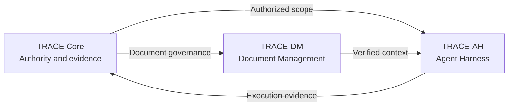

# TRACE-GATE Framework

**English** | [한국어](README.ko.md)

An evidence-based framework for software delivery governance: connect requests, authorized scope, canonical document context, observed effects, and permission to continue across interrupted agent sessions.

This repository contains specifications, machine-readable contracts, a Python reference implementation, and synthetic tests. The architecture is a research proposal; the implementation exercises selected contracts. Passing its tests does not establish production safety, distributed authorization, or operational effectiveness.

**Official repository:** [401SPAG/trace-gate-framework](https://github.com/401SPAG/trace-gate-framework) · [401SPAG](https://401spag.com) · [Contact](mailto:mail@401spag.com)

## What TRACE means

| Principle | Meaning | Question |
|---|---|---|
| **T — Trace** | Trace requests, decisions, and evidence | Why is the work needed, and what was approved? |
| **R — Restrict** | Limit authority and effects | What may change, and what must remain protected? |
| **A — Assemble** | Compose bounded capabilities with recovery paths | How can the work be divided into manageable units? |
| **C — Confirm** | Establish facts through evidence | What was observed, and what remains unknown? |
| **E — Elevate** | Grant further operating authority through a Gate | When may the next stage be authorized? |

A **Gate** is an evidence-based decision point, not an acronym. A passing evaluation alone does not grant execution or promotion authority. The five TRACE principles here are distinct from other projects named TRACE.

## Three responsibilities

| Area | Responsibility |
|---|---|
| **TRACE Core** | Requests, boundaries, approvals, evidence, and decisions about further authority |
| **TRACE-DM — Document Management** | Canonical documents, revisions, lineage, integrity, freshness, and purpose-limited context |
| **TRACE-AH — Agent Harness** | Mediated model/tool execution, observations, verification, checkpoints, and verified resumption |



These are logical responsibilities and can share a deployment. Summaries and search results are derived context; relevance does not make them authoritative. Optional semantic retrieval, multi-agent coordination, and TRACE-DM-MIGRATION extend particular use cases.

## Conditions to preserve

- Bind the request, approval, scope, and relevant document revisions **before an effect**.
- Distinguish an attempted action, a reported success, and an observed effect. A timeout is not evidence that nothing changed.
- Keep unresolved writes blocked in the same run. Investigate actual effects before deciding on recovery or a newly authorized run.
- Resume only after approval, context, execution history, scope, and original limits remain valid. A checkpoint alone is not permission to resume.
- Supply trusted observation and approval resolvers, protected evidence and independent ledger anchors, and host-enforced concurrency controls where required.

The reference runtime is a single-process example. Its Python handler timeout is checked after the handler returns; it does not forcibly stop a running tool. Production executors must provide their own isolation, deadlines, and effect reconciliation. See the [implementation guide](docs/REFERENCE-IMPLEMENTATION.en.md).

## Start locally

Review the [license scope](LICENSING.en.md) before using the software. Package metadata requires Python **3.11+**; use **3.12** to reproduce CI. A Python 3.15 gzip compatibility issue is recorded in the [implementation guide](docs/REFERENCE-IMPLEMENTATION.en.md#1-install-and-inspect). From a repository checkout, use a project virtual environment (POSIX commands):

```bash
python3.12 -m venv .venv
.venv/bin/python -m pip install -e '.[dev]'
.venv/bin/python scripts/validate_templates.py
.venv/bin/python -m pytest -q
.venv/bin/python scripts/evaluate_gate.py \
  templates/gate-decision.yaml examples/gate-facts.yaml
.venv/bin/python examples/runtime_demo.py
```

The examples use synthetic inputs and do not perform remote mutations. They do not connect a production model, cloud credentials, or an operational approval service. [Example guide](examples/README.md).

Begin with `request-receipt.yaml`, `ticket.yaml`, `evidence-manifest.yaml`, and `gate-decision.yaml` in [`templates/`](templates/). Add document access/read/manifest contracts for TRACE-DM, and `agent-run.yaml` plus `tool-definition.yaml` for TRACE-AH. Use `templates/HANDOFF.md` for session continuity. The [documentation map](docs/README.md) links the optional contracts and detailed specifications.

## Documentation and versions

| Read next | English | 한국어 |
|---|---|---|
| Documentation map and terminology | [Guide](docs/README.md) | [안내](docs/README.ko.md) |
| Reference implementation | [Usage guide](docs/REFERENCE-IMPLEMENTATION.en.md) | [상세 가이드](docs/REFERENCE-IMPLEMENTATION.ko.md) |
| Examples | [Examples](examples/README.md) | [예제](examples/README.ko.md) |
| Contributions | [Guide and terms translation](CONTRIBUTING.en.md) | [기여 절차·합의 원문](CONTRIBUTING.md) |
| Licensing | [Scope guide](LICENSING.en.md) | [적용 범위](LICENSING.md) |

The detailed Core, DM, AH, and migration specifications are currently in Korean and are linked in both documentation maps. English entry guides identify this explicitly. [Change history](CHANGELOG.md) and the [TRACE-DM document manifest](docs/managed-document-manifest.yaml) track repository documentation.

Repository version markers are independent: Python package **2.0.1**, Core **1.1.0**, DM **0.2.0**, AH **0.1.0**, optional DM-MIGRATION **0.1.0**. These are not an announcement of a package-registry release. Package 2.0.x records licensing changes without changing the 1.2.0 execution logic. The earlier 1.2.0 hardening introduced breaking adapter requirements; preserve historical receipts/checkpoints and consult the implementation guide before migration.

## License and contributions

Copyright © 2026 D. JEONG and the respective contributors.

- **Documentation:** [CC BY-NC-ND 4.0](LICENSE). Noncommercial sharing of unadapted material is allowed with the required notices; commercial use or sharing translations/adaptations requires separate permission unless another applicable permission or exception covers it.
- **Software and machine-readable contracts:** [401SPAG Noncommercial Software License 1.1](LICENSE-CODE). It permits noncommercial execution, study, private modification, and unmodified redistribution with notices. Commercial use/distribution and external distribution of modified software require separate permission unless otherwise authorized. A business pilot or customer proof of concept does not become noncommercial merely because it is free.
- **Contributions:** purpose-limited official review permissions and an additional, explicit integration/sublicensing agreement are distinct. See [CONTRIBUTING](CONTRIBUTING.en.md).

Earlier valid permissions, including CC BY and code license 1.0, and independent rights under applicable hosting-platform terms remain available for the material they cover. This distribution is publicly readable source with use and redistribution restrictions; it is not described as OSI-approved open source. The guides do not change the operative licenses or past agreements. [Scope and precedence](LICENSING.en.md) · [Separate permissions](mailto:mail@401spag.com).
